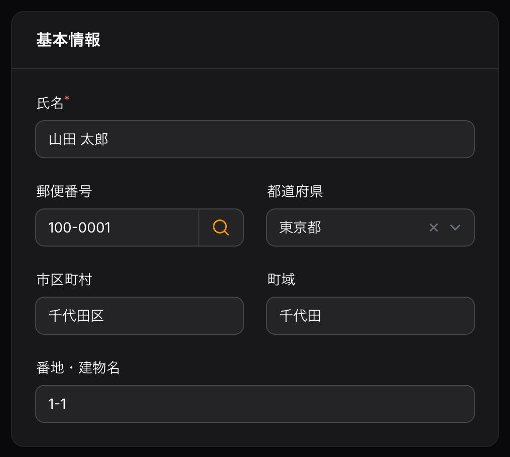
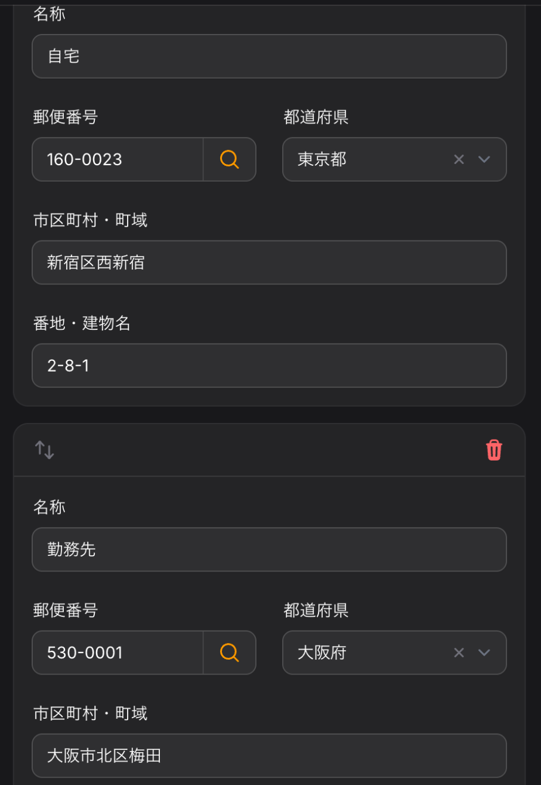

# Filament JP Postal

[](https://github.com/holyat-dev/filament-jp-postal/actions/workflows/tests.yml)

[日本語](#日本語) | [English](#english)

---

## 日本語

郵便番号を入力すると、都道府県・市区町村・町域を自動で入力する [Filament](https://filamentphp.com) v5 用のフォームフィールドです。

- `PostalCodeInput` — 7 桁そろった時点で自動検索、「住所検索」ボタン、Repeater 内でも動作
- `PrefectureSelect` — 47 都道府県のセレクト（値は名前または JIS コード `01`〜`47`）
- データソースはドライバで切り替え可能：`zipcloud`（初期値）／`database`（日本郵便のデータを取り込み）
- 全角数字・IME 入力に対応、表示は常に `100-0001`

<p>
  
  
</p>

### 動作環境

- PHP 8.2 以上
- Laravel 12 / 13
- Filament 5.8.3 以上
- ZIP を取り込む場合は `zip` 拡張

### インストール

```bash
composer require holyat/filament-jp-postal
```

設定ファイルを公開する場合：

```bash
php artisan vendor:publish --tag=filament-jp-postal-config
```

`database` ドライバを使う場合は、マイグレーションを公開して実行します。

```bash
php artisan vendor:publish --tag=filament-jp-postal-migrations
php artisan migrate
```

### 使い方

#### 1. 基本

```php
use Filament\Forms\Components\TextInput;
use Holyat\FilamentJpPostal\Forms\Components\PostalCodeInput;
use Holyat\FilamentJpPostal\Forms\Components\PrefectureSelect;

PostalCodeInput::make('zipcode')
    ->fillsAddress(prefecture: 'prefecture', city: 'city', town: 'town'),
PrefectureSelect::make('prefecture'),
TextInput::make('city')->label(__('filament-jp-postal::messages.city')),
TextInput::make('town')->label(__('filament-jp-postal::messages.town')),
```

`PostalCodeInput` と `PrefectureSelect` のラベルは自動で翻訳されます（「郵便番号」「都道府県」）。
自分で用意する市区町村・町域のフィールドには、パッケージの翻訳キー `city`・`town`・`city_town` を使えます。

#### 2. Repeater の中で使う

`fillsAddress()` のパスは同じ階層からの相対パスなので、Repeater の各項目はその項目のフィールドだけを埋めます。

```php
use Filament\Forms\Components\Repeater;

Repeater::make('addresses')->schema([
    PostalCodeInput::make('zipcode')
        ->fillsAddress(prefecture: 'prefecture', city: 'city', town: 'town'),
    PrefectureSelect::make('prefecture'),
    TextInput::make('city')->label(__('filament-jp-postal::messages.city')),
    TextInput::make('town')->label(__('filament-jp-postal::messages.town')),
]),
```

#### 3. ハイフン付きで保存・都道府県コード・市区町村と町域を 1 項目に

```php
PostalCodeInput::make('zipcode')
    ->storeWithHyphen()                   // 保存値を 100-0001 にする（初期値は 1000001）
    ->fillsAddress(
        prefectureCode: 'pref_code',      // 都道府県コード（'13'）を入れる
        cityTown: 'address1',             // 市区町村＋町域（'千代田区千代田'）を入れる
    ),
PrefectureSelect::make('pref_code')->codes(), // 値は '01'〜'47'（常に文字列）
TextInput::make('address1')->label(__('filament-jp-postal::messages.city_town')),
```

#### オプション

| メソッド | 初期値 | 説明 |
|---|---|---|
| `fillsAddress(prefecture:, prefectureCode:, city:, town:, cityTown:)` | — | 入力先のフィールド（相対パス） |
| `autoLookup(bool)` | `true` | 7 桁そろったら自動検索。同じ郵便番号では再検索しない |
| `lookupAction(bool)` | `true` | 「住所検索」ボタンを表示 |
| `overwrite(bool)` | `true` | `false` なら値が入っているフィールドは変更しない |
| `storeWithHyphen(bool)` | `false` | 保存形式を `100-0001` にする |
| `driver(string)` | 設定の `default` | このフィールドだけ別のドライバを使う |

#### 検索結果の扱い

- 1 件：すべて入力します。
- 複数件：全件で共通の都道府県・市区町村だけを入力し、町域は空にして通知します。
- 0 件：通知を表示し、直前の検索で自動入力したフィールドのうち、利用者が書き換えていないものだけを空にします。
- 通信エラー：通知を表示します（フォームの送信は妨げません）。

#### 保存と表示の形式

- 保存：初期値は `1000001`。`storeWithHyphen()` で `100-0001`。
- 表示：保存形式に関係なく、読み込み時に `100-0001` に変換します。`formatStateUsing()` や `afterStateHydrated()` を付けても、この変換のあとに実行されます。
- 入力：全角数字・各種ハイフン・`〒` を受け付け、`000-0000` に整えます。IME の変換中は値を書き換えません。

#### 注意：`getRawState()` に見えるキー

直前に自動入力した値を覚えておくため、フォームのデータに `{フィールド名}__jp_postal_filled`（例：`zipcode__jp_postal_filled`）というキーを書き込みます。
`getState()`（通常の保存処理）からは取り除かれるのでデータベースには保存されませんが、`getRawState()` や Livewire の `$data` を直接読むと見えます。

### サービスとして使う

```php
use Holyat\FilamentJpPostal\Facades\JpPostal;

$addresses = JpPostal::lookup('100-0001');                    // Collection<Address>
$addresses = JpPostal::driver('database')->lookup('1000001');

$address = $addresses->first();
$address->prefecture;      // 東京都
$address->fullAddress();   // 東京都千代田区千代田
```

`JpPostal::extend('custom', fn () => new MyDriver)` で独自のドライバ（`PostalCodeDriver` を実装）を追加できます。

### ドライバの選び方

**本番環境では `database` ドライバをおすすめします。** 外部サービスに依存せず、レスポンスも安定します。

```dotenv
JP_POSTAL_DRIVER=database
```

#### `zipcloud`（初期値）

[zipcloud](https://zipcloud.ibsnet.co.jp) の郵便番号検索 API を使います。設定なしで試せますが、次の点に注意してください。

- **利用規約は利用者ご自身で確認し、同意したうえでお使いください**：<https://zipcloud.ibsnet.co.jp/rule/api>
- **郵便番号検索の機能だけを提供することを目的としたサイトでは利用できません**（規約で禁止されています）。
- 提供元は予告なくサービスを停止・終了したり、呼び出し回数を制限したりすることがあり、保証はありません。
- 結果はキャッシュします（初期値 30 日、該当なしは 1 日）。`cache.ttl` で調整できます。

#### `database`

日本郵便の「住所の郵便番号（1レコード1行、UTF-8形式）」を取り込んで検索します。

```bash
php artisan jp-postal:import                     # 日本郵便から ZIP をダウンロードして取り込む
php artisan jp-postal:import --file=utf_ken_all.zip
php artisan jp-postal:import --url=https://example.com/utf_ken_all.zip
```

- 取り込み中は一時テーブルに書き込み、最後に入れ替えるので、取り込み中も検索できます。
- 本番環境（`APP_ENV=production`）では確認が出ます。スケジューラなどでは `--force` を付けてください。

月 1 回の更新例（`routes/console.php`）：

```php
use Illuminate\Support\Facades\Schedule;

Schedule::command('jp-postal:import --force')->monthly();
```

### 町域の正規化

日本郵便のデータの町域欄には住所ではない注記が含まれるため、取り込み時に次の規則で整えます（2026 年 10 月更新の全 124,527 行で検証済み）。

1. `以下に掲載がない場合` → 空
2. `○○の次に…がくる場合` → 空（後ろに括弧があっても）
3. `○○一円` → 空（`一円` だけの場合は実在の地名なので残す）
4. 最初の `（` から最後の `）` までを削除（例：`西新宿（次のビルを除く）` → `西新宿`）
5. 地割の範囲・列挙は最初の数字または `第` の手前まで（例：`越中畑６４地割〜越中畑６６地割` → `越中畑`）。単一の地割（`芦ケ沢７２地割`）は残す
6. 1〜5 のあとも `、` が残る町域の列挙（例：`井道、奥井道、内井道`）→ 空

町域カナにも同じ規則を適用します。正規化の結果、同じ郵便番号に同じ住所が複数できた場合は、検索時に 1 件にまとめます。

### データの出典

`database` ドライバのデータは日本郵便株式会社が公開している郵便番号データです。データそのものはこのパッケージに含まれていません。各自の環境でダウンロードしてください。

- 郵便番号データ：日本郵便株式会社
- 取得元（初期値）：<https://www.post.japanpost.jp/service/search/zipcode/download/utf/zip/utf_ken_all.zip>

### 翻訳

`ja`・`en`・`ko` を同梱しています。変更する場合は公開してください。

```bash
php artisan vendor:publish --tag=filament-jp-postal-translations
```

### テスト

```bash
composer test
composer analyse
composer format
```

### ライセンス

MIT。詳しくは [LICENSE.md](LICENSE.md) を参照してください。

---

## English

A [Filament](https://filamentphp.com) v5 form field that fills in the prefecture (都道府県), city (市区町村) and town (町域) from a Japanese postal code.

- `PostalCodeInput` — looks up automatically once 7 digits are entered, has a lookup button, and works inside a Repeater
- `PrefectureSelect` — the 47 prefectures (the value is the name or the JIS code `01`–`47`)
- Swappable data source: `zipcloud` (default) or `database` (imports Japan Post's data)
- Accepts full-width digits and IME input; always shows `100-0001`

<p>
  
  
</p>

### Requirements

- PHP 8.2+
- Laravel 12 / 13
- Filament 5.8.3+
- The `zip` extension to import ZIP files

### Installation

```bash
composer require holyat/filament-jp-postal
```

To publish the config file:

```bash
php artisan vendor:publish --tag=filament-jp-postal-config
```

For the `database` driver, publish and run the migration:

```bash
php artisan vendor:publish --tag=filament-jp-postal-migrations
php artisan migrate
```

### Usage

#### 1. Basic

```php
use Filament\Forms\Components\TextInput;
use Holyat\FilamentJpPostal\Forms\Components\PostalCodeInput;
use Holyat\FilamentJpPostal\Forms\Components\PrefectureSelect;

PostalCodeInput::make('zipcode')
    ->fillsAddress(prefecture: 'prefecture', city: 'city', town: 'town'),
PrefectureSelect::make('prefecture'),
TextInput::make('city')->label(__('filament-jp-postal::messages.city')),
TextInput::make('town')->label(__('filament-jp-postal::messages.town')),
```

`PostalCodeInput` and `PrefectureSelect` come with translated labels. For your own city and town fields, the package's translation keys `city`, `town` and `city_town` are available.

#### 2. Inside a Repeater

The paths given to `fillsAddress()` are relative to the field's own level, so each Repeater item fills only its own fields.

```php
use Filament\Forms\Components\Repeater;

Repeater::make('addresses')->schema([
    PostalCodeInput::make('zipcode')
        ->fillsAddress(prefecture: 'prefecture', city: 'city', town: 'town'),
    PrefectureSelect::make('prefecture'),
    TextInput::make('city')->label(__('filament-jp-postal::messages.city')),
    TextInput::make('town')->label(__('filament-jp-postal::messages.town')),
]),
```

#### 3. Storing with a hyphen, prefecture codes, city and town in one field

```php
PostalCodeInput::make('zipcode')
    ->storeWithHyphen()                   // store 100-0001 (default: 1000001)
    ->fillsAddress(
        prefectureCode: 'pref_code',      // fills the prefecture code ('13')
        cityTown: 'address1',             // fills city + town ('千代田区千代田')
    ),
PrefectureSelect::make('pref_code')->codes(), // values '01'–'47', always strings
TextInput::make('address1')->label(__('filament-jp-postal::messages.city_town')),
```

#### Options

| Method | Default | Description |
|---|---|---|
| `fillsAddress(prefecture:, prefectureCode:, city:, town:, cityTown:)` | — | Target fields (relative paths) |
| `autoLookup(bool)` | `true` | Look up once 7 digits are entered; the same postal code is not looked up twice |
| `lookupAction(bool)` | `true` | Show the lookup button |
| `overwrite(bool)` | `true` | When `false`, fields that already have a value are left alone |
| `storeWithHyphen(bool)` | `false` | Store as `100-0001` |
| `driver(string)` | config `default` | Use another driver for this field |

#### How results are handled

- One result: every target field is filled.
- Several results: only the prefecture and city shared by all results are filled; the town is cleared and a notification is shown.
- No result: a notification is shown, and the fields the previous lookup filled are cleared, unless the user has changed them since.
- Connection errors: a notification is shown; the form can still be submitted.

#### Stored and displayed format

- Stored: `1000001` by default, `100-0001` with `storeWithHyphen()`.
- Displayed: always converted to `100-0001` when the form is filled, whatever the stored format. `formatStateUsing()` and `afterStateHydrated()` callbacks run after this conversion.
- Input: full-width digits, hyphen-like characters and `〒` are accepted and formatted as `000-0000`. The value is never changed while an IME is composing.

#### Note: a key visible in `getRawState()`

To remember what it filled last, the field writes a key named `{field name}__jp_postal_filled` (e.g. `zipcode__jp_postal_filled`) into the form data.
It is removed from `getState()` (the normal save path), so it never reaches the database, but you will see it when reading `getRawState()` or the Livewire `$data` directly.

### Using the service

```php
use Holyat\FilamentJpPostal\Facades\JpPostal;

$addresses = JpPostal::lookup('100-0001');                    // Collection<Address>
$addresses = JpPostal::driver('database')->lookup('1000001');

$address = $addresses->first();
$address->prefecture;      // 東京都
$address->fullAddress();   // 東京都千代田区千代田
```

Register your own driver (implementing `PostalCodeDriver`) with `JpPostal::extend('custom', fn () => new MyDriver)`.

### Choosing a driver

**The `database` driver is recommended in production.** It does not depend on a third-party service and responds consistently.

```dotenv
JP_POSTAL_DRIVER=database
```

#### `zipcloud` (default)

Uses the [zipcloud](https://zipcloud.ibsnet.co.jp) postal code search API. It works without any setup, but please note:

- **Read the terms of use and make sure you agree to them yourself before using it**: <https://zipcloud.ibsnet.co.jp/rule/api>
- **It must not be used on a site whose purpose is only to provide postal code search** (forbidden by the terms).
- The operator may suspend or end the service, or limit the number of calls, without notice, and gives no warranty.
- Results are cached (30 days by default, 1 day for no match). Adjust with `cache.ttl`.

#### `database`

Imports and searches Japan Post's 「住所の郵便番号（1レコード1行、UTF-8形式）」 data.

```bash
php artisan jp-postal:import                     # download the ZIP from Japan Post and import it
php artisan jp-postal:import --file=utf_ken_all.zip
php artisan jp-postal:import --url=https://example.com/utf_ken_all.zip
```

- Rows are written to a temporary table that replaces the live one at the end, so lookups keep working during an import.
- In production (`APP_ENV=production`) the command asks for confirmation. Pass `--force` from the scheduler.

Monthly update (`routes/console.php`):

```php
use Illuminate\Support\Facades\Schedule;

Schedule::command('jp-postal:import --force')->monthly();
```

### Town name normalization

The town (町域) column of Japan Post's data mixes town names with notes that are not part of an address. The import cleans it with these rules, verified against all 124,527 rows of the October 2026 update:

1. `以下に掲載がない場合` → empty
2. `○○の次に…がくる場合` → empty, even with a trailing parenthesis
3. `○○一円` → empty (`一円` alone is a real place name and is kept)
4. Everything from the first `（` to the last `）` is removed (`西新宿（次のビルを除く）` → `西新宿`)
5. Ranges and lists of 地割 are cut before the first digit or `第` (`越中畑６４地割〜越中畑６６地割` → `越中畑`); a single 地割 (`芦ケ沢７２地割`) is kept
6. A list of towns still containing `、` after rules 1–5 (`井道、奥井道、内井道`) → empty

The same rules apply to the town kana. When normalization leaves the same address several times for one postal code, lookups return it once.

### Data source

The `database` driver uses the postal code data published by Japan Post Co., Ltd. (日本郵便株式会社). The data itself is not included in this package; it is downloaded in your own environment.

- Postal code data: Japan Post Co., Ltd. (日本郵便株式会社)
- Default source: <https://www.post.japanpost.jp/service/search/zipcode/download/utf/zip/utf_ken_all.zip>

### Translations

`ja`, `en` and `ko` are included. Publish them to customize:

```bash
php artisan vendor:publish --tag=filament-jp-postal-translations
```

### Testing

```bash
composer test
composer analyse
composer format
```

### License

MIT. See [LICENSE.md](LICENSE.md).
